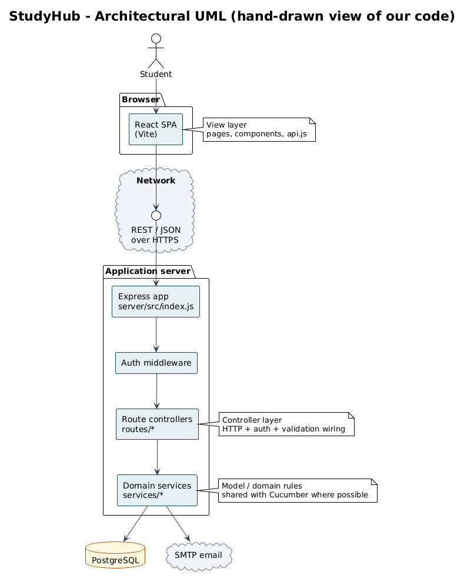
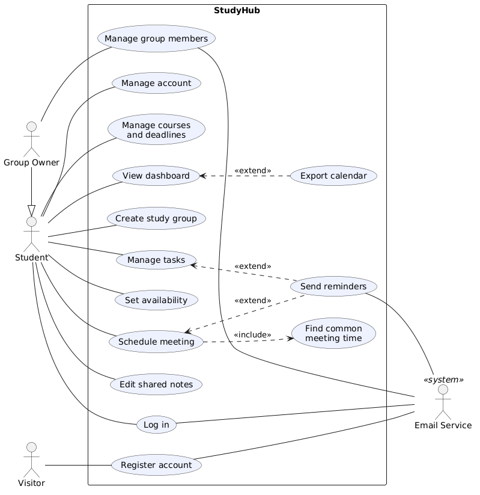
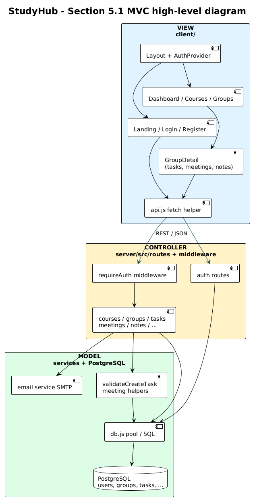
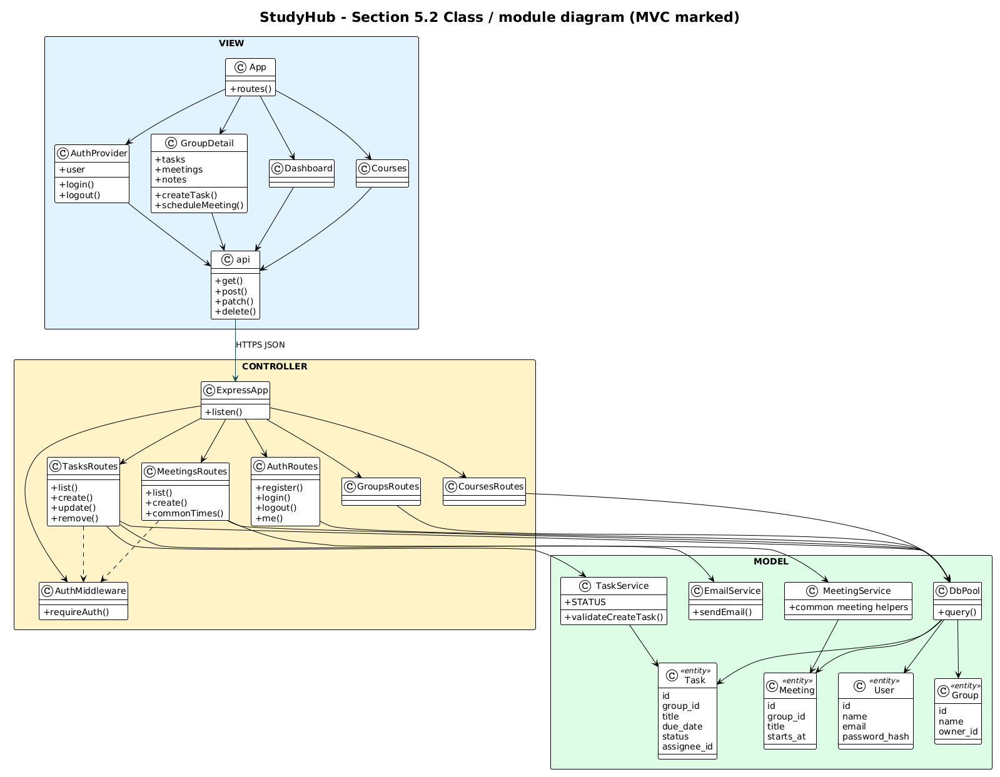
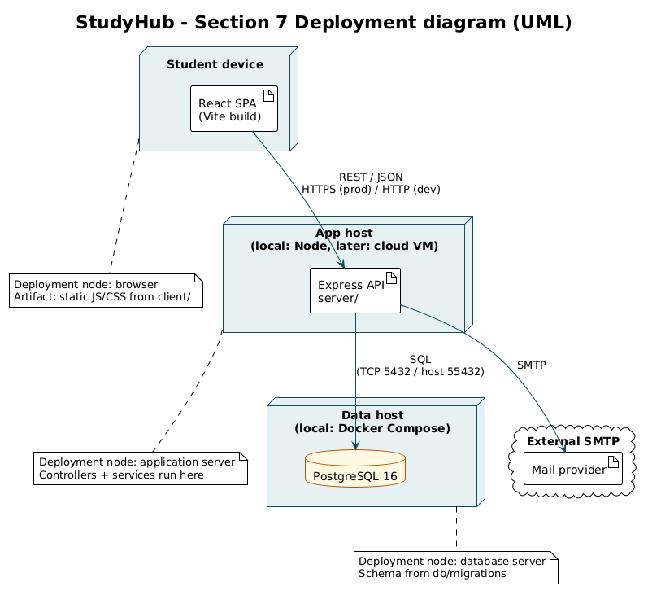
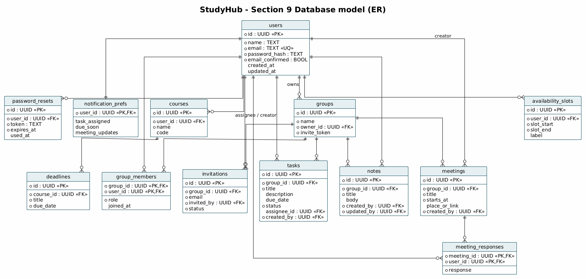

# Week 7: Architecture, MVC and the RUP Software Architecture Document

*By Ergens Hyso, Kristine Megrelishvili and Antonio Kanani*

Week 6 put StudyHub on YouTrack with RUP tags. This week we document the **Lifecycle Architecture**: how the running React / Express / PostgreSQL code is structured, how it maps to MVC, and how that fills the RUP Software Architecture Document.

The filled document (online in the repo):

[StudyHub Software Architecture Document (RUP)](../architecture/rup-software-architecture.md)

## 1. Our chosen framework stack

The homework asks which framework we chose (Laravel, Django, Rails, Spring, …). StudyHub is not built on one of those full-stack MVC frameworks. We chose a small JavaScript stack that the whole team can read and that already matches our Cucumber tests:

| Layer | Choice | Why |
| :---- | :---- | :---- |
| Front end (View) | **React** with Vite and React Router | Screens in the browser, works on phone and desktop |
| Back end (Controller) | **Node.js + Express** REST API | Same language as our tests; clear HTTP routes |
| Data (Model) | **PostgreSQL** with SQL migrations | Clear tables for users, groups, tasks, meetings |

That decision was already sketched in [Week 2](week-02-team-technology-setup.md). This week we treat it as the architecture we must prove, not only describe.

## 2. Does our stack generate simple CRUD and do we use that?

**No.** Express and React do **not** generate Create / Read / Update / Delete screens or controllers the way Rails scaffolds or Django admin can.

We write CRUD ourselves:

- Controllers: route files such as `server/src/routes/tasks.js` (`GET`, `POST`, `PATCH`, `DELETE`).
- Views: React pages such as `GroupDetail.jsx` that call `client/src/api.js`.
- Model: SQL in migrations (`db/migrations/001_init.sql`) and queries in the routes; domain checks in `server/src/services/`.

We are fine with that. Our Cucumber scenarios already encode the rules for *Create a task* and *Schedule meeting*; generated admin CRUD would not reuse those rules.

## 3–5. Screencasts (Cucumber / demo)

- **Cucumber running:** already on the blog in [Week 5](week-05-testing-with-cucumber.md) (feature files + CI). If the lecturer wants a fresh short screencast, we re-record `npm test` into the test blog.
- **First demo / live feature tests:** optional this week; we show the app and/or Cucumber live online when asked and link the film here when we have it.

## 6–7. Architectural UML (hand-drawn) and overlay

We drew an architectural UML of **our** code (browser SPA, Express, services, PostgreSQL, SMTP):

- Source: [architectural-uml.puml](../diagrams/architectural-uml.puml)
- It matches the earlier context diagram from Week 2 ([architecture.png](../diagrams/architecture.png)).

**Overlay homework:** in WebStorm / IntelliJ, generate a UML / structure diagram from the project modules (`client`, `server`, `src`). Export that image, then place our hand-drawn architectural UML on top (or side-by-side with the same boxes labelled View / Controller / Model). Keep both images in `docs/diagrams/` and embed them in this post when the IDE export is ready.

> **Team action:** export the IDE auto-UML screenshot and add `docs/diagrams/ide-generated-uml.png`, then a combined overlay image if the course expects one file.

## 8. RUP architecture document — filled and online

Sections below follow the course checklist. Full prose lives in the [SAD](../architecture/rup-software-architecture.md).

### Section 2 — Model–View–Controller

StudyHub uses MVC across client and server: React is the **View**, Express routes (+ auth middleware) are the **Controller**, PostgreSQL and `services/*` are the **Model**. Details in SAD §2.

### Section 3 — Our MVC tooling

React + Express + PostgreSQL — not Laravel/Django/Rails/Spring scaffolding. No auto-CRUD (see above). SAD §3.

### Section 4 — Overall use case diagram

Embedded from Week 3:

PlantUML source: [use-case-diagram.puml](../diagrams/use-case-diagram.puml)

### Section 5 — Logical view

#### 5.1 MVC high-level diagram

PlantUML: [mvc-overview.puml](../diagrams/mvc-overview.puml) — View (`client/`), Controller (`server/src/routes` + auth), Model (`services` + PostgreSQL + SMTP).

#### 5.2 Class diagram with MVC sections marked

PlantUML packages **VIEW**, **CONTROLLER**, **MODEL**: [mvc-class-diagram.puml](../diagrams/mvc-class-diagram.puml)

### Section 6 — Process view

N/A for this hand-in (request/response web app).

### Section 7 — Deployment

We have a client/server deployment:

UML source: [deployment.puml](../diagrams/deployment.puml). Local ports today: client `5173`, API `4000`, Postgres host `55432`.

### Section 8 — Implementation view

N/A / light — folder layout is listed in the SAD.

### Section 9 — DB model

ER-style PlantUML from our migration: [db-model.puml](../diagrams/db-model.puml)  
Schema source of truth: [`db/migrations/001_init.sql`](../../db/migrations/001_init.sql)

JetBrains DataGrip (or the IDE database tool) can also auto-produce an EER diagram from the live Postgres connection for comparison.

### Sections 10–11

Optional / N/A.

## What we still do by hand for the grade

1. Capture the **IDE-generated** UML (WebStorm / IntelliJ diagram from `client` + `server`) and overlay it with [architectural-uml.png](../diagrams/architectural-uml.png) (§6–7).
2. Publish this post on WordPress and link the [SAD](../architecture/rup-software-architecture.md) from About.
3. Optional: re-record a short Cucumber / demo screencast if the lecturer asks for a fresh film.

## Reflection on AI use

For this weeks blog we used Cursor AI to turn the course checklist into a StudyHub SAD and PlantUML diagrams that match the real folders (`client/`, `server/src/routes`, `services`, migrations). Stack choices, MVC mapping and which sections are N/A are team decisions grounded in the code we already run .
