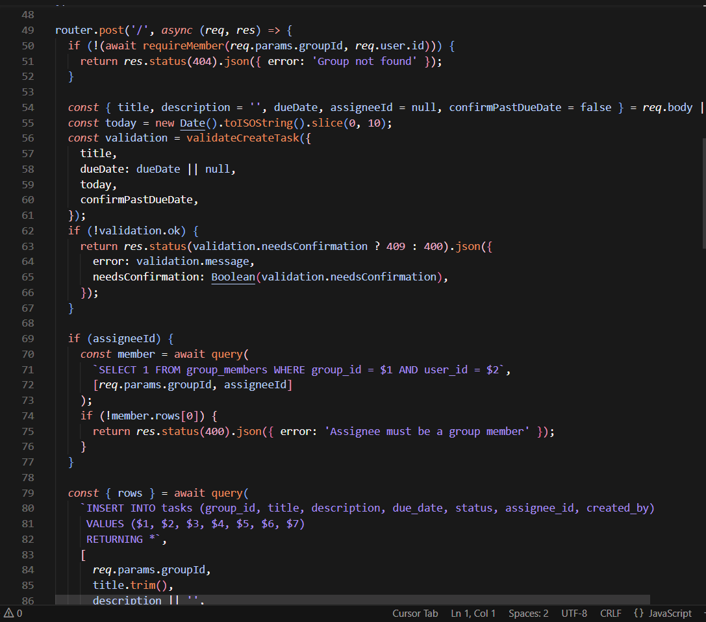
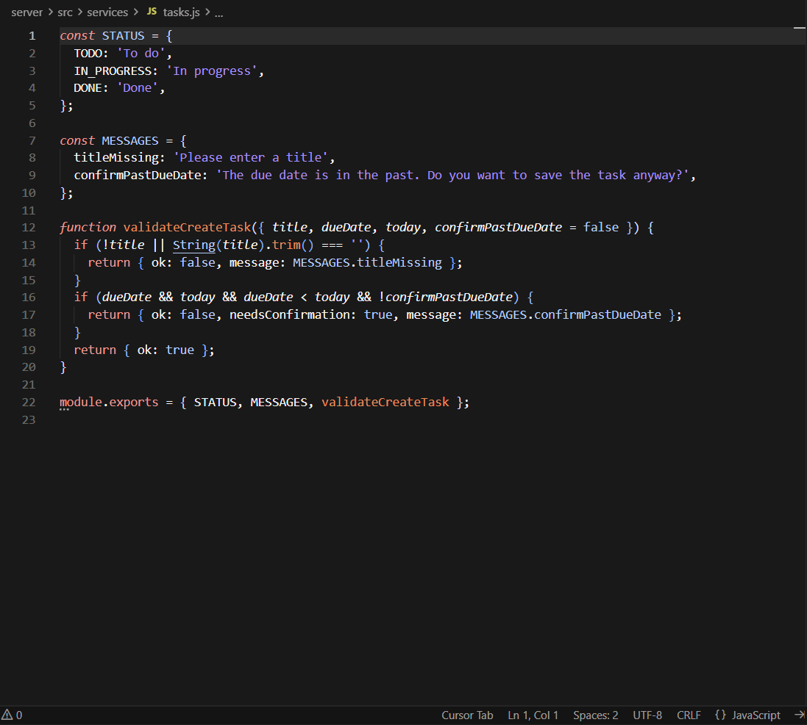
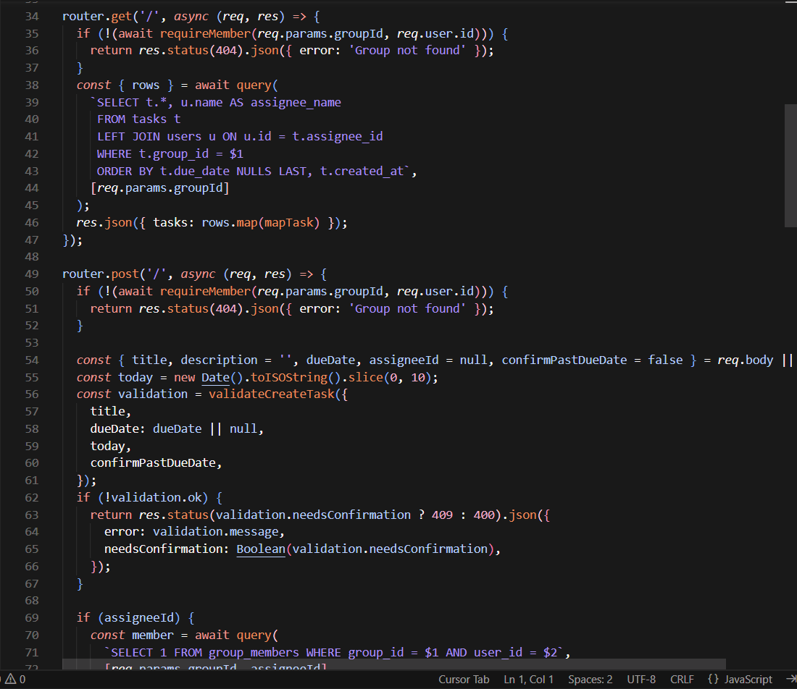
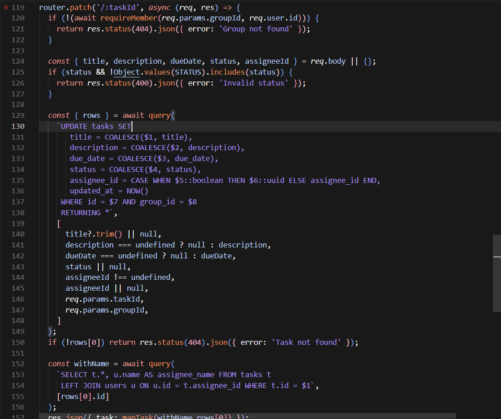
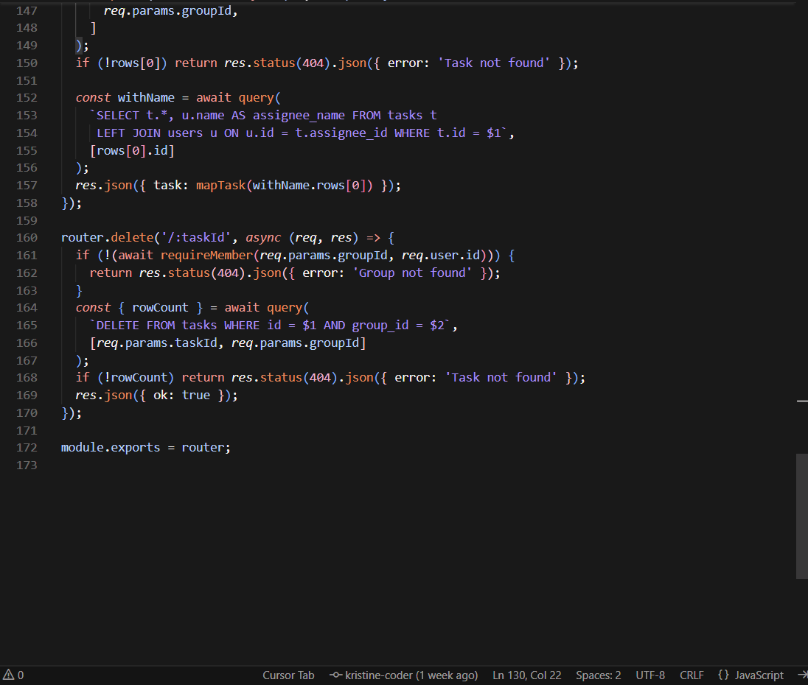
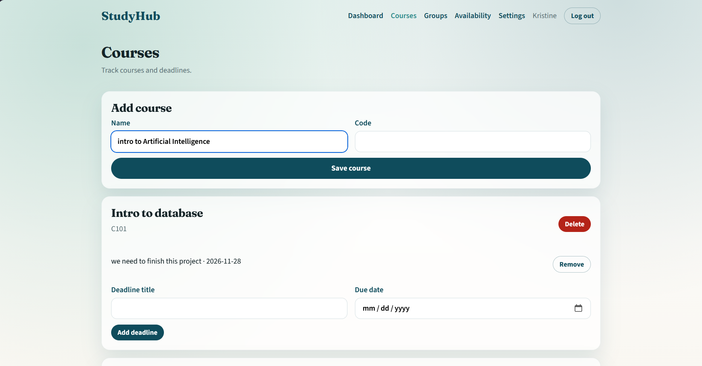
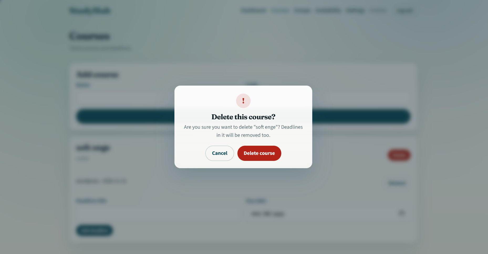
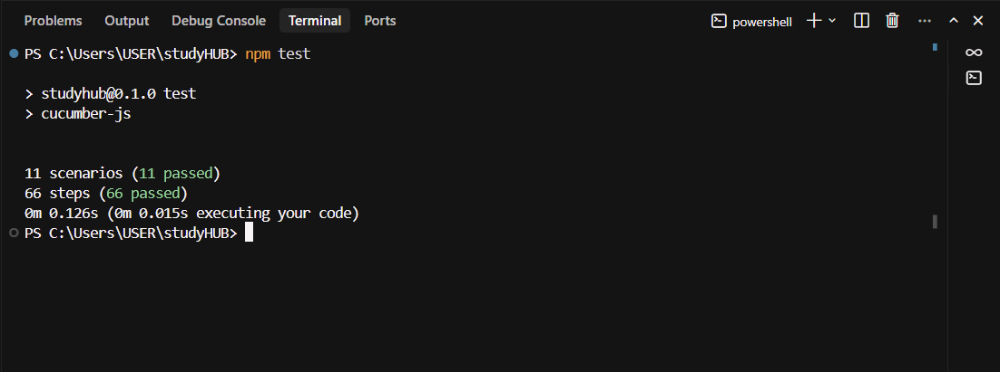
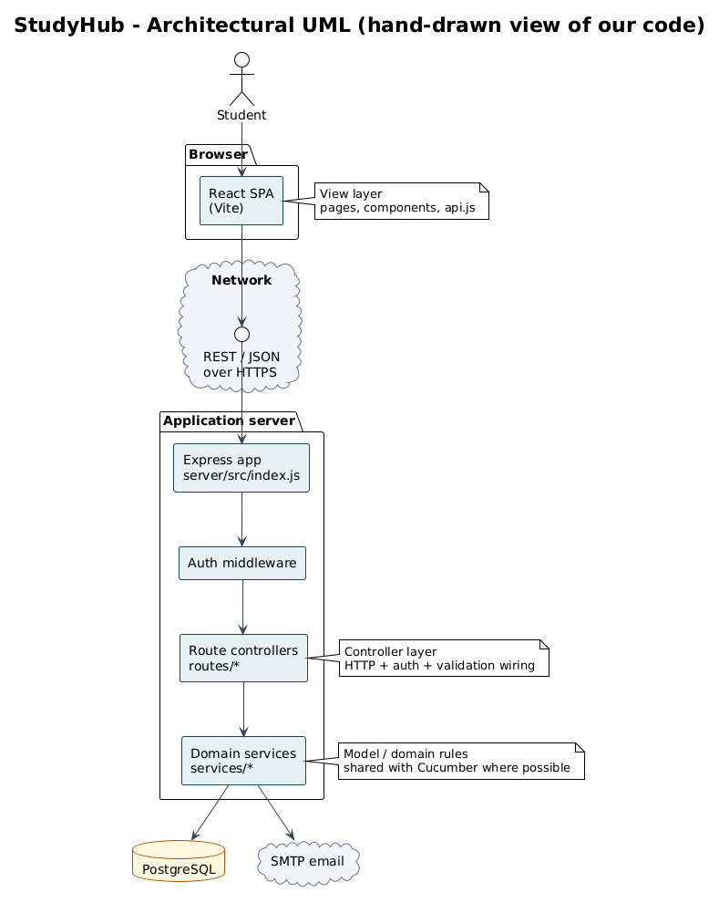
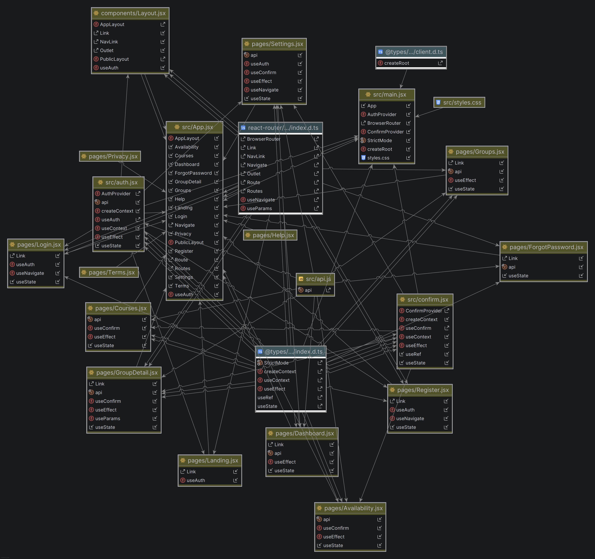

# Week 8: From Architecture to Features — Task CRUD in StudyHub

*By Ergens Hyso, Kristine Megrelishvili and Antonio Kanani*

Last week we published our [Software Architecture Document](../architecture/rup-software-architecture.md): React as View, Express as Controller, PostgreSQL + services as Model, and a clear answer that our stack does **not** auto-generate CRUD. This week we put that architecture to work. We take one High-priority use case — **Create a task** — and show how Create / Read / Update / Delete actually look in our code, why we keep the routes hand-written, and how Cucumber still guards the rules.

> Other teams labelled the architecture hand-in as “Week 8”. We did that document as [Week 7](week-07-architecture-mvc.md). This post is the next step: **from diagrams to a working feature**.

## 1. Reminder: our framework and the CRUD question

| Layer | Tool | Auto-CRUD? |
| :---- | :---- | :---- |
| View | React + Vite | No scaffolds |
| Controller | Express routers | No generated routes |
| Model | PostgreSQL + SQL + `services/` | No ORM admin |

We still write every endpoint and every screen. The win is control: membership checks, past-due confirmation, and assignee validation stay next to the use-case rules we already tested with Cucumber.

Full framework write-up: [Week 7 §1–2](week-07-architecture-mvc.md).

## 2. Why we do not generate generic CRUD

A generic “CRUD for `tasks`” would expose create / list / update / delete without StudyHub rules. Our task API must:

1. require a logged-in user (`requireAuth`),
2. require **group membership** before any read or write,
3. validate title and past due dates (`validateCreateTask`),
4. reject assignees who are not in the group,
5. optionally email the assignee.

That is the same argument WolfStreet made for watchlists: a CRUD helper can shorten SQL, but **ownership and validation stay in our routes**. We chose not to add a library like FastCRUD; the task surface is small enough that plain `pg` queries in `server/src/routes/tasks.js` stay readable.

## 3. Task CRUD mapped to our architecture

| CRUD | HTTP | Where | MVC |
| :---- | :---- | :---- | :---- |
| Create | `POST /api/groups/:groupId/tasks` | `tasks.js` + `GroupDetail.jsx` | Controller + View |
| Read | `GET /api/groups/:groupId/tasks` | same | Controller + View |
| Update | `PATCH /api/groups/:groupId/tasks/:id` | status / fields | Controller + View |
| Delete | `DELETE /api/groups/:groupId/tasks/:id` | same | Controller |

Domain rules live in the Model layer (`server/src/services/tasks.js`, shared with Cucumber via root `src/`). Persistence is the `tasks` table from [`db/migrations/001_init.sql`](../../db/migrations/001_init.sql).

```text
GroupDetail (View)
    --api.js-->  tasks router (Controller)
                     --> validateCreateTask (Model)
                     --> SQL INSERT/SELECT/... (Model)
                     --> sendEmail (side effect)
```

### Create — what the controller does

1. `requireAuth` → cookie session.
2. `requireMember(groupId, userId)` → 404 if not in the group.
3. `validateCreateTask` → 400 missing title, or 409 if due date is in the past and the user has not confirmed.
4. Optional assignee must be a group member.
5. `INSERT INTO tasks …` then JSON response; email if assigned.



Domain rules for create live in the Model (`validateCreateTask`):



### Read / Update / Delete

- **Read** lists tasks for the group (membership required), ordered by due date.
- **Update** changes status or fields for a task that belongs to that group.
- **Delete** removes a task after the same membership check.







## 4. View side: React is not a generated admin

`GroupDetail.jsx` owns the task form and the list. It calls `api.post` / `api.get` / `api.patch` / `api.delete`. There is no scaffolded table UI. The past-due confirmation dialog is a View concern that mirrors the 409 from the Controller.

Create a task on the group board:



Delete uses a confirmation dialog before calling the API:



## 5. Proof with Cucumber (and optional demo)

The feature file for *Create a task* still encodes title required and past-due confirmation. Domain helpers are shared with the server, so the architecture and the tests stay aligned.

`npm test` — 11 scenarios, 66 steps passed:



Optional: short **demo film** of create → assign → mark Done in the browser.

## 6. Closing last week’s open homework

| Item from Week 7 | Status this week |
| :---- | :---- |
| IDE project / structure view next to our architectural diagram | Done — Project tree screenshot below |
| SAD online | Done — [rup-software-architecture.md](../architecture/rup-software-architecture.md) |
| Week 7 on WordPress | Done |

### Architecture + IDE view





## 7. What we learned

Choosing Express was only half the decision. The other half is **how** we use it: custom routes with membership and validation beat a generated CRUD table that would ignore our use cases. Week 7 explained the map; Week 8 walks one road on that map — task CRUD from View through Controller into Model, with Cucumber still watching the rules.

## Reflection on AI use

For this weeks we used Cursor AI to compare other teams’ Week 8 posts with our Week 7 hand-in and to draft this “architecture → feature” outline. The choice to deepen task CRUD instead of rewriting the SAD, and the membership / validation examples, are team decisions grounded in `server/src/routes/tasks.js` and our Cucumber scenarios.

---

### Team checklist before WordPress

- [x] Screenshots: task route code, GroupDetail task UI, Cucumber terminal
- [x] IDE project view next to architectural UML
- [ ] Optional demo screencast
- [ ] Publish + category **Week 8** + About link
